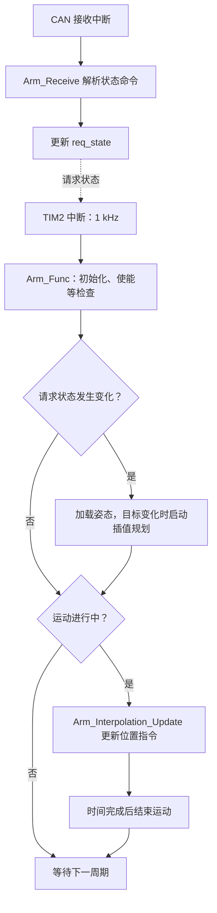

# 四自由度机械臂控制工程

本项目基于 STM32H723ZETx、STM32 HAL 和 FreeRTOS，实现天空块抓取、翻转、保持及放置等动作。三个位置电机中，两个负责俯仰运动，一个负责平动；GIM4310 独立控制末端旋转，将天空块翻转至己方颜色面朝上。

## 电机与配置

| 电机 | 作用 | 代码对象 | 条件编译宏 | 当前值 |
| --- | --- | --- | --- | --- |
| Unitree GO-M8010-6 | 俯仰运动 | `Unitree_motors[0]` | `RotaryU1_USE` | `1` |
| DJI M3508 | 俯仰运动 | `DJmotor[1]` | `RotaryDJ_USE` | `1` |
| U8Lite | 平动 | `Zmotor[1]` | `PrismaticZ1_USE` | `0` |
| GIM4310 | 末端旋转、天空块翻转 | `Zmotor[0]` | `RotaryZ1_USE` | `1` |

代码入口：[电机对象绑定](User/src/seize_sky.c#L540)、[四个电机配置宏](User/inc/sky_config.h#L15)。

四个宏用于条件编译，方便单电机调试，也便于在某个电机出现故障时裁剪其业务访问，继续调试其余电机。`1` 表示启用，`0` 表示裁剪对应的机械臂结构体成员和访问代码，见[条件编译成员](User/inc/seize_sky.h#L62)。这些宏不关闭驱动层通信；驱动类型、数量和总线另见 [motor_config.h](Config/motor_config.h)。当前平动电机未参与机械臂业务编译。

当前 `USE_FK`、`USE_IK` 均为 `0`，默认使用关节空间电机位置目标；旧机构的运动学调试代码须在新机构标定后再启用，见[运动学开关说明](User/inc/sky_config.h#L4)。

## 控制框架

CAN 接收中断负责接收新状态，TIM2 中断负责状态切换和插值运动更新，两者通过 `ArmControl.req_state` 衔接。



1. **接收请求**：FDCAN 接收回调调用 [`Arm_Receive()`](Application/src/IQRhandler.c#L150)。该函数根据 CAN ID 查找状态映射，更新请求状态，不在接收中断内执行运动规划，见[状态命令解析](User/src/seize_sky.c#L912)。
2. **切换状态并更新目标**：TIM2 以 1 kHz 调用 [`Arm_Func()`](Application/src/IQRhandler.c#L43)。请求状态与当前状态不同且有效时，加载对应姿态；完整目标发生变化时，调用 `Arm_Interpolation_Start()`，以当前实际位置作为插值起点，见[状态切换](User/src/seize_sky.c#L715)和[插值初始化](User/src/seize_sky.c#L379)。
3. **持续执行插值**：运动更新位于状态切换分支之外，因此不需要每周期接收新命令，也不要求每周期切换状态。初始化完成、已使能且 `ArmControl.running` 为真时，每个 TIM2 周期都会调用 [`Arm_Interpolation_Update()`](User/src/seize_sky.c#L812)，直到运动时间完成。插值计算、目标下发和完成处理见[插值更新函数](User/src/seize_sky.c#L452)。

这里的“无条件运行插值”指不受“本周期是否发生状态切换”限制；代码仍有初始化、使能和运动状态检查。

### 状态表与扩展

[`ArmState_t`](User/inc/seize_sky.h#L26) 定义状态，包含天空块横/竖预取、横/竖抓取、末端旋转、保持、放置，以及球的预取、抓取和放置。[`Arm_Pose_Table`](User/src/seize_sky.c#L22) 按状态索引保存三个位置电机的目标值和运动时间，末端旋转角度独立管理。

状态表将姿态数据与通用状态执行流程分离。新增普通姿态时：

1. 在 `ArmState_t` 的 `ARM_STATE_COUNT` 前添加新枚举。
2. 在 `Arm_Pose_Table` 中添加对应条目，填写位置和运行时间。U1 使用 rad，DJI 和 U8Lite 使用驱动位置角度 deg，时间使用 s，见[表项定义](User/inc/seize_sky.h#L61)。
3. 若需通过 CAN 触发，在 [sky_config.h](User/inc/sky_config.h#L31) 配置状态 CAN ID，并在[接收映射表](User/src/seize_sky.c#L890)添加映射。

普通姿态扩展无需改动通用插值执行逻辑，符合开闭原则；新的特殊动作仍需补充其专用行为。

**当前状态命令 CAN ID 均为待配置的 `0`，接收逻辑会跳过这些条目。** 联调前需按主控协议分配有效 ID。使能、失能和复位命令独立配置，见[命令定义](User/inc/sky_config.h#L49)与[命令处理](User/src/seize_sky.c#L920)。

### GIM4310 独立旋转

末端支持相对机械零位顺时针 90°、顺时针 180°和逆时针 90°三个独立旋转状态，见[旋转状态判定](User/src/seize_sky.c#L641)。离散角度使用各自标定的驱动绝对位置值，见[标定参数](User/inc/sky_config.h#L25)和[末端目标选择](User/src/seize_sky.c#L218)。

收到独立旋转状态时，先将上一段另外三个电机的目标位置赋给新姿态，再将包含 GIM4310 新角度的完整姿态用于插值目标更新，见[保留位置目标并组装旋转姿态](User/src/seize_sky.c#L748)。这样不会因旋转状态表中的占位值而改变机械臂的位置目标：

- 原位置运动已完成时，另外三个电机保持原目标位置，末端独立旋转。
- 原位置运动仍在进行时，另外三个电机继续朝原目标运动，不会冻结在收到旋转命令的瞬间。新的运动时间取剩余时间与 `ARM_END_MIN_REPLAN_TIME` 的较大值；当前最短时间为 1.5 s。

## 夹爪与电磁阀控制

控制链路为：**机构板 → CAN 指令 → 电磁阀板 → 对应通道输出电平 → 电磁阀切换状态 → 夹爪开闭**。电磁阀板接收通道开闭指令后，控制对应输出是否给高电平，驱动电磁阀完成夹爪动作。

### 四通道协议

机构板向电磁阀板发送标准 CAN 数据帧：

| 字段 | 定义 |
| --- | --- |
| CAN ID | `0x423` |
| 数据长度 | 1 字节 |
| bit0 | CH1，`1` 开、`0` 闭 |
| bit1 | CH2，`1` 开、`0` 闭 |
| bit2 | CH3，`1` 开、`0` 闭 |
| bit3 | CH4，`1` 开、`0` 闭 |

使用数据字节的低四位，依次对应 CH1–CH4。例如 `0x05`（`0000 0101`）打开 CH1、CH3，关闭 CH2、CH4；发送示例中其余位取 `0`。

### 当前代码实现

[`Jaw_Func()`](User/src/holding_jaw.c#L19) 检测夹爪开闭值变化，将 `0x423` 标准帧加入 FDCAN3 的夹爪发送队列。[TIM2 回调](Application/src/IQRhandler.c#L53)周期调用 `Jaw_Func()` 并将 `JawTxqueue` 出队发送。

当前 [`Jaw_Switch_t`](User/inc/holding_jaw.h#L9) 中的当前值和上一值均为 `bool`，因此只能保存 `0/1`，按上述位序只能表达 CH1 开闭，尚不能保留完整四通道位掩码。[`Jaw_Receive()`](User/src/holding_jaw.c#L38) 定义了扩展帧 `0x01010405`、2 字节载荷、首字节为 `'R'` 的上游接收格式，但当前[中断分发](Application/src/IQRhandler.c#L150)未调用该函数。四通道协议能力与当前单通道状态实现需区分。

## 目录与开发入口

| 目录 | 内容 |
| --- | --- |
| `User/` | 机械臂状态机、轨迹插值、夹爪与业务配置 |
| `Application/` | 中断回调、任务及应用入口 |
| `Motor/` | 电机驱动、CAN 队列 |
| `Config/` | 板级、电机驱动及应用配置 |
| `Algorithm/`、`BSP/` | 算法与板级支持 |
| `Core/`、`Drivers/`、`Middlewares/` | CubeMX 生成代码、HAL、FreeRTOS 等 |
| `MDK-ARM/` | Keil 工程 |
| `Tools/`、`DOCS/` | 编译脚本、主机测试及参考文档 |

使用 Keil 打开 [27RC_Proj_Template.uvprojx](MDK-ARM/27RC_Proj_Template.uvprojx) 编译下载。也可在项目根目录执行：

```powershell
# 增量编译 / 全量编译，需要本机安装 Keil uVision
powershell -File Tools\build.ps1
powershell -File Tools\build.ps1 -Rebuild

# 主机侧机械臂控制测试，需要 Python 3 和 GCC
python Tools/tests/test_arm_states.py
```

编译器路径参数、日志位置及主机测试覆盖范围见 [Tools 使用说明](Tools/README.md)。主机测试不替代固件编译和上机标定。

相关文档：[文档索引](DOCS/README.md)、[工程架构](DOCS/architecture.md)、[硬件说明](DOCS/hardware_notes.md)、[移植指南](DOCS/porting_guide.md)、[VOFA+ 调试](DOCS/vofa_plus.md)。其中通用模板与历史机构说明作为参考，当前机械臂逻辑以本文链接的实际代码为准。
